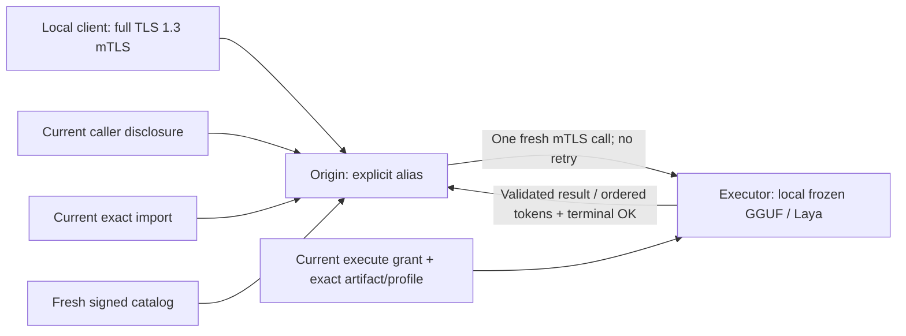

# Opt-in single-hop runtime

Federation is disabled unless `MDMA_FEDERATION_CONFIG` selects a reviewed local
runtime configuration and an existing, correctly bound trust store. Creating
that file does not enroll peers or approve any model/caller permissions.



## Independent switches

The existing runtime TLS/signing/issuer/listener fields remain mandatory.
These workload fields all default to off/empty:

```toml
poll_catalogs = true
enable_execution = false
enable_routing = true

[[routes]]
alias = "reviewed-remote-model"
peer_id = "executor.example.test"
model = "explicit-export-name"
artifact_id = "sha256:<64 reviewed lowercase hex digits>"
profile_id = "sha256:<64 reviewed lowercase hex digits>"
operation = "synthesize" # or "decide"
```

Replace placeholder digests with actual catalog identities. URLs, empty/default
model names, wildcards, failover lists and local-model-shadowing aliases are
invalid. A route is pinned to exactly one executor/artifact/profile/operation.
Use the alias in the ordinary client RPC's `model` field. Routing aliases are
operator configured. `Introspect` includes aliases only for an actually
authenticated caller with current disclosure/import consent and a fresh exact
ready catalog. It reveals no executor URL and reserves no execution resources.

On the executor, separately set `enable_execution = true` and approve the
origin peer's exact `execute_exports`. The origin requires polling, an exact
`route_imports` grant and local `Store::approve_disclosure(Disclosure)` consent
for the actual client SPKI, peer, remote model, operation and finite window.
Removing consent or imports cancels work. Catalog, execution, import and caller
disclosure permissions are independent. No new flag creates a grant.

Use the native `mdma-serve` path, which freezes consumed model artifacts, warms up,
captures actual profiles and attaches the native controller. Control-only mode
cannot activate execution/routing. CPU GGUF, native Metal/ROCm/Vulkan GGUF and
CPU Laya are supported. GPU decoders require a current concrete-backend
[GPU execution profile](execution-profile-gpu-v1.md); CUDA/Level Zero remain
unprofiled. GPU-enabled builds still serve Laya on CPU.

## Client authentication and deadlines

Ordinary local/default RPCs retain their existing semantics. Routed
calls require an actual **full TLS 1.3, HTTP/2, authenticated-client handshake**
and one positive `grpc-timeout`, captured before protobuf decoding. Normal
client certificates need no federation URI identity. HTTP headers and claimed
caller IDs cannot create a principal.

TLS1.2, anonymous or resumed local connections cannot route. The MDMA mTLS
client helper disables resumption; custom clients must do likewise. Client
issuers remain separate from federation issuers and server keys.

The origin subtracts routing, dialing and negotiation time, caps execution at
300 seconds and additionally bounds it by actual caller/consent and peer
credential lifetimes. It never resets the received deadline or redispatches
after a failure, even before `Accepted`. Failed transport outcomes are ambiguous.

The `mdma-client` binary accepts `MDMA_RPC_TIMEOUT_MS=30000` (1..300000) for both
workload operations. Set it together with `MDMA_MODEL=<approved-alias>` for
routing. Leaving it unset preserves ordinary local calls without a deadline.

A routed `chat` request (`MDMA_CHAT=1`, optionally `MDMA_SYSTEM`) is wrapped
on the origin, in the chat format the executor's fresh signed catalog
advertises for that model, and forwarded as a plain prompt; the executor sees
no new field. A model whose catalog names no format refuses `chat` before any
dial, as does a system message without `chat`.

An origin that only routes needs no local models: `mdma-serve` accepts an
empty `MDMA_MODELS_DIR` when routing is enabled, and refuses it otherwise.

## Bounded lifetime and output

The origin permits one active/undrained routed response, eight client
connections and two concurrent decoders without a waiting queue. The existing
ordinary protobuf message size bound remains in force; the route validates
the advertised 64KiB input cap before dialing. Remote token messages are capped
at 64KiB, with one event in the origin handoff. There is no output collector.

An independent supervisor checks fixed deadlines, shutdown and current trust/
consent while a client is not polling. Dropping/resetting the client call drops
the owned remote connection. Quota remains charged through RPC/body lifetime.
Authorization is checked again before queued token and encoded frame release.
Already handed-off/in-flight transport bytes cannot be recalled.

The origin sends all resolved sampler fields explicitly, including preserved
zero values, so another executor build cannot silently supply different defaults.

Synthesis success requires validated `Accepted → Token* → Completed → gRPC OK`.
The origin checks the selected identity/request ID, resolved sampler/caps,
contiguous token indexes, output limits, completion count/reason/timings and
final status. Missing/extra/corrupt events fail; partial output remains a
failure and is never supplemented from another executor.

With `emit_events`, a routed call reports the executor's admission and
completion like a local one: `accepted` (prompt tokens, output cap, `n_ctx`)
once the executor's `Accepted` validates, and `completed` (emitted tokens,
finish reason, the executor's prefill and decode milliseconds) only after the
whole stream, gRPC `OK` included, has validated. A failed run never ends with
`completed`. A degraded executor's lower caps show up in `accepted`. Unary decisions validate identity,
result size and typed question/result schema, including duplicate keys.

## Operations and acceptance

Trust APIs publish atomically, persist before success and notify running
controllers. A running store has one locked writer; never edit its JSON or
unlink either trust or machine lock. `mdma-fed` (below) changes a node only
while its `mdma-serve` is stopped; restart it afterwards. A running server
changes its own trust only for installs and live route imports (below). Lost
or corrupt trust is never recreated automatically.

A routed request rechecks, on every trust change and every 50 ms, what it
was admitted under: the caller's consent, the route's exact import, and the
peer's state and binding. Losing any of them ends it; other edits, such as
another route's import or another caller's consent, do not. A cached catalog
stays usable while its peer's state and credentials are unchanged: a new
state, key, pin or endpoint withdraws that peer's catalog at once and polls
it again, grant edits keep it.

Conformance includes actual two-leg HTTP/2 mTLS loopback inference, native
synthesis/Laya parity, resumption rejection, deadlines/reset/drop/revocation,
response quotas and malicious executor output/no-redispatch tests.

### Setting up nodes with mdma-fed

Each node keeps its federation files in one directory:

```sh
mdma-fed init /var/lib/mdma/fed --id pathfinder.fleet --endpoint https://192.168.3.41:6365
mdma-fed export /var/lib/mdma/fed > pathfinder.json
```

`init` makes a root and identity certificate (the id is the DNS name and
identity URI), a catalog signer, the trust store and `runtime.toml`, valid for
`--days` (30 by default, at most 397). The root's key is not kept: renewing is
a new `init` and enrolling the new bundle with `--replace` on each peer.
`export` prints the public bundle and, on stderr, its digest; `enroll` prints
the digest it read, so the two can be compared over another channel.

On each side, enroll the other's bundle:

```sh
# executor: periscope may see and run every model in its models folder
mdma-fed enroll /var/lib/mdma/fed periscope.json --execute all --models /srv/models
# origin: control only; --endpoint dials the peer somewhere else
mdma-fed enroll ~/.mdma/fed pathfinder.json --endpoint https://192.168.3.41:6365
```

`--catalog` and `--execute` take `all` or a comma list; the catalog defaults
to what the peer may run. Enrolling the same bundle again replaces its grants;
a known peer with other credentials is refused unless `--replace` is given:
its old credentials are then suspended and the new bundle staged with the
grants given. Routes imported from the old identity are dropped, so run
`mdma-fed routes` again on that side; keys the trust store retired or revoked
stay refused. Execute grants turn on `enable_execution`.

Start the executor with `MDMA_FEDERATION_CONFIG=<dir>/runtime.toml`. Then, with
the origin stopped:

```sh
mdma-fed routes ~/.mdma/fed --peer pathfinder.fleet --client-cert certs/client.pem
```

This reads the peer's signed catalog and routes each ready model as
`pathfinder-<model>` (`--prefix` changes it) for that one client certificate,
replacing the peer's earlier routes, and turns routing and polling on. Run it
again after the peer's models change, or, once the origin routes, have it
import them while it serves, from a client pinned in its `MDMA_ADMIN_SPKI`:

```sh
mdma-client --routes pathfinder.fleet
```

That does what `mdma-fed routes` does, for the calling client, in one trust
write, and saves `runtime.toml`: requests on routes it keeps carry on, and the
new routes select at once. An origin that does not route yet starts with
`mdma-fed routes`. `mdma-fed status <dir>` shows peers, grants and routes, also
while the node runs.

### Pushing models to a peer

A node can take GGUFs from a peer over the federation listener, so a machine
nobody logs into can start with an empty models folder and be filled later.
On the receiving node, with its server stopped:

```sh
# the peer may push models here while 20 GiB stay free, and sees and runs
# every model any peer installs here
mdma-fed enroll /var/lib/mdma/fed periscope.json --install 20G --installed
```

`--install` and `--installed` are separate grants. Pushing a model grants
nobody anything; every peer with `--installed` sees and runs every installed
model, whoever pushed it, so another origin keeps the same view. A node whose
peers may install may start with no models.

From the pushing node while it serves, with a client whose pin is in that
server's `MDMA_ADMIN_SPKI`, for a file in its models folder:

```sh
mdma-client --push pathfinder.fleet Qwen3-8B-Q4_K_M qwen3-8b
```

or, with that node stopped, for any file:

```sh
mdma-fed push ~/.mdma/fed ~/models/Qwen3-8B-Q4_K_M.gguf --peer pathfinder.fleet --name qwen3-8b
```

Then route what it sent, live with `mdma-client --routes pathfinder.fleet`
or with the pushing node stopped:

```sh
mdma-fed routes ~/.mdma/fed --peer pathfinder.fleet --client-cert certs/client.pem
```

A push hashes the file and sends its name, size and digest first. One runs at
a time per server; `mdma-client` prints progress and stops the push when it
is interrupted. The receiver answers from everything it holds:

- **Already installed** under any name: nothing is sent; `push` prints the name.
- **One of its own models** has those bytes: it links the new name to that
  file, so nothing is sent and the weights load once.
- **Otherwise** it refuses a taken name or an upload that would leave less than
  the floor free, and else takes the file.

The file streams into a hidden `.install-<digest>.part` in the models folder,
one upload at a time, outside the two request slots inference uses. The
receiver checks size and digest, links it into place (never replacing a file),
waits until its size and times have been still for two seconds (FreeBSD's
soft updates change a moved file's ctime about half a second later, which
would read as the file changing under a loaded model), reads it as startup
would, and serves it without a restart. A file that is
not a model it can serve is removed. Hidden uploads cut short are removed when
the node next starts. `mdma-fed status` lists each installed model and who
pushed it.

The receiver keeps installs in its trust store, so they outlive restarts, and
recording one counts as a trust change: a request being admitted at that
moment fails once. There is no uninstall yet; delete the file and restart to
drop one, after which its name can be installed again.

### Hardware acceptance

Development acceptance used independently enrolled ARM64/x86_64 macOS and
x86_64 Linux hosts, a real TinyLlama GGUF and the ordinary mTLS client:

| Executor | Checked |
|---|---|
| CPU (macOS ARM64 and x86_64) | Bidirectional verified catalogs, two-leg synthesis, typed decisions with a generated Laya checkpoint |
| Metal (Apple silicon) | Synthesis through an approved alias with validated terminal completion; eager and request-owned paths have separate checkpoint gates |
| Vulkan (Linux, discrete NVIDIA GPU) | Synthesis with exact pins; device/kernel checks, frozen-resource parity, mode-change withdrawal, checkpoint greedy/logprob parity |
| ROCm f32 reference (Linux, RDNA4) | Checkpoint greedy/logprob parity, serialized ROCm library suite, three-host delegation |
| CUDA (Linux, RTX 3070 Ti Laptop, sm_86) | Two-leg synthesis through an approved alias, CPU decisions, deadline and reset cancellation |
| CPU (FreeBSD 16.0-CURRENT amd64) | Library suite, kernel-backed executable identity including replace/unlink withdrawal |
| Five-host fleet set up with `mdma-fed` (macOS Metal origin; CUDA, ROCm f32 and two FreeBSD CPU executors) | Verified catalogs from every executor with models on disk; synthesis through CUDA and FreeBSD routes loading on first use; a gateway lease evicting an idle CUDA model to load another; the executor lease ending within its TTL after the origin was killed, and returning when it restarted |

All runs rejected missing deadlines, wrong operations and unapproved caller
disclosure; unapproved callers could not see route aliases. GPU runs also
failed closed on wrong artifact/profile pins and completed independent work
after a dropped stream. Previously approved routes stayed usable alongside new
aliases. These are not production throughput benchmarks or fleet
certification, and Level Zero federation remains unqualified.

### Deployment notes

For the ROCm reference-mode server, set `MDMA_BACKEND=rocm` and `MDMA_HIP_F32=1`.
`mdma-serve` validates the latter as `0` or `1` (default `0`) and freezes the selection
at startup. Reference mode uses GPU f32 activations/KV without WMMA/int8 or graph
execution; its numerical mode is part of the profile pin. The known fast ROCm
checkpoint drift remains unqualified: no tolerances were relaxed to enable it.

On macOS, Local Network privacy blocks a program's LAN connections until the
user allows it. Programs run from Terminal or SSH, launchd daemons and root are
exempt; a program started from another app, such as an editor or a third-party
terminal, counts as that app and is allowed only if that app is. A peer
reachable from an interactive shell therefore says nothing about the daemon.

`mdma-serve` and `mdma-fed` embed an Info.plist that names them and says why,
and macOS remembers the answer by code signature, so sign them with an
Apple-issued identity:

```sh
just features=metal sign "Apple Development: Your Name (TEAMID)"
```

Run the signed `mdma-serve` as a launchd agent (`deploy/launchd/`, or
`launchctl submit` for a session) and allow it when macOS asks. After a
rebuild, macOS may refuse the first dials (`HostUnreachable`) while it checks
the new binary, or ask again; catalog polling retries, so peers come back once
it allows them. Run `mdma-fed routes` from Terminal
or SSH, or allow the app it runs from. Do not disable OS policy or tunnel
around a denial.
Diagnostics report only static failure stages and OS error kinds, not private
transport error text.

The real Laya checkpoint tested did **not** qualify: `tokenizers` 1.0.0-rc.2
requires all 256 ByteLevel atoms and rejects its vocabulary at byte `0xC0`.
No token IDs/checkpoint bytes were altered to bypass that error. The generated
decision fixture demonstrates transport/native execution, not real classifier
readiness. Validate actual checkpoint compatibility separately.

This is service-level request delegation, not GPU/RAM pooling, model transfer
or tensor/KV sharding. GPU execution is whole-request delegation to one
independently provisioned executor, not multi-GPU execution of one model.
